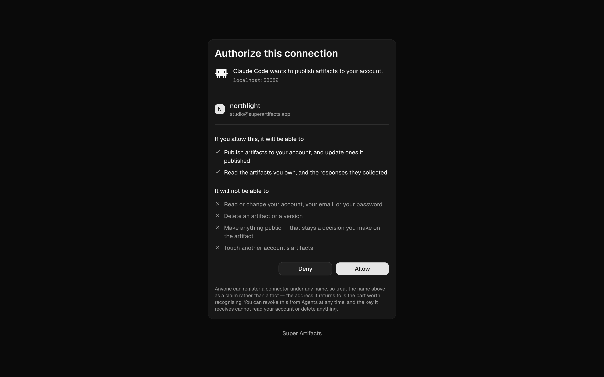
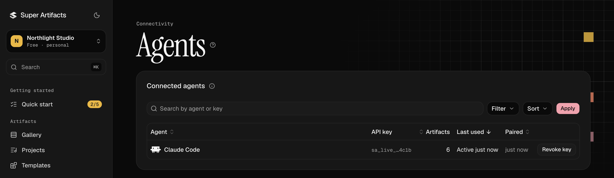
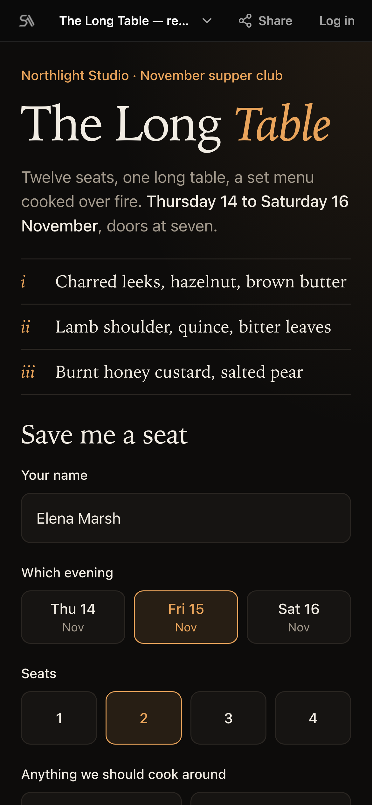
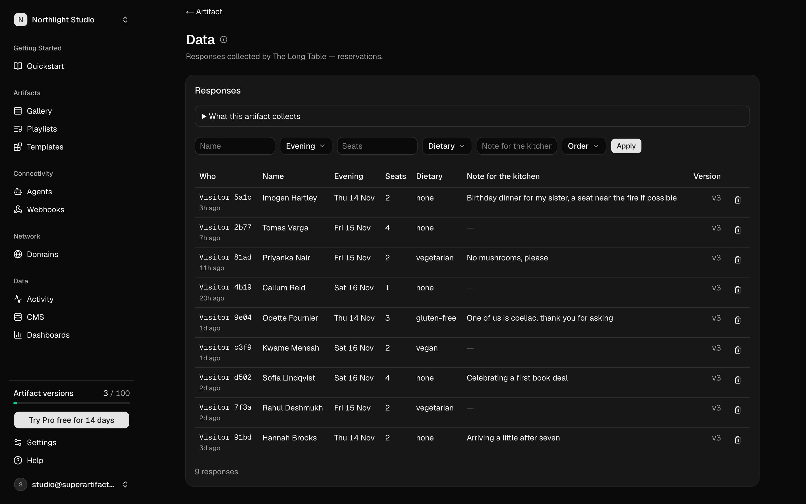
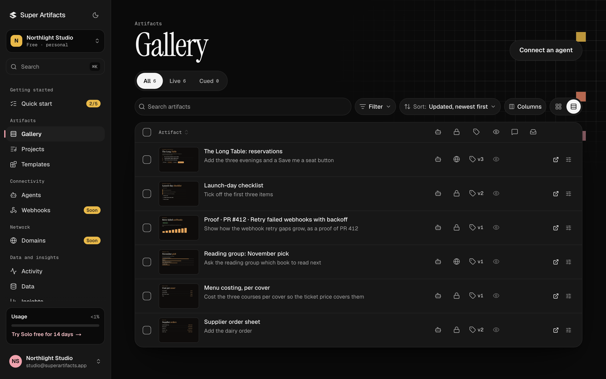
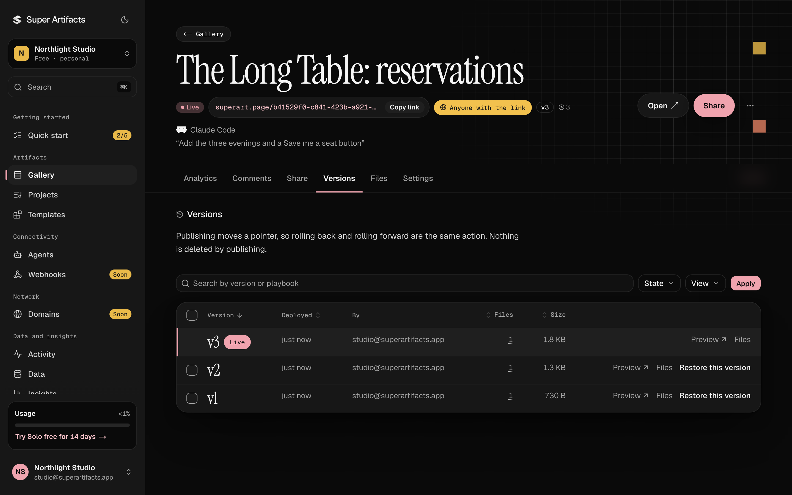

<!--
  This file is the ROOT README of github.com/Super-Artifacts/plugins, a mirror.
  It lives at plugins/marketplace/README.md in the private repo and is copied to
  the public repo's root by .github/workflows/plugin-marketplace.yml, and
  plugins/marketplace/assets/ is copied to the public assets/. Every relative
  path below (assets/..., super-artifacts/docs/...) is relative to the PUBLIC
  repo root, not to this file's home. The
  plugin-marketplace check assembles the tree the way the workflow does and
  fails when any of them does not resolve there.
-->
<p align="center">
  <picture>
    <source media="(prefers-color-scheme: dark)" srcset="assets/brand/logo-on-dark.png">
    <source media="(prefers-color-scheme: light)" srcset="assets/brand/logo-on-light.png">
    
  </picture>
</p>

<h3 align="center">Turn what your agent builds into something people can use.</h3>

<p align="center">
  <a href="https://superartifacts.app">superartifacts.app</a> ·
  <a href="https://superartifacts.app/docs">Docs</a> ·
  <a href="https://superartifacts.app/pricing">Pricing</a> ·
  <a href="super-artifacts/docs/connect/README.md">Connect your agent</a>
</p>

---

Super Artifacts is where the things your coding agent builds go to be opened. An agent publishes a page, a form, a tracker or a walkthrough, and gets back a live URL that works on a phone. Visitors can answer what you built, and your agent reads the answers back and can change the page, all through the same connection.

This repository is the public side of it: the MCP endpoint to point your agent at, the guides for each agent, and the plugin for each place agents are installed from: Claude, ChatGPT and Codex, and Hermes.

## What it does

- **It is data-driven.** An artifact can declare what it collects. Visitors' answers land in a hosted database, and the agent that published it reads them back, as rows or as totals.
- **It works across agents.** Any agent that can talk to an MCP server connects to one URL and signs in through your browser. There is a guide for each one, [linked below](#connect-in-30-seconds).
- **Templates save tokens.** When someone has already built the thing you want, your agent installs that template and fills it in instead of writing it again from nothing.
- **Projects group artifacts.** Put artifacts in an order, or let a rule fill the list, and present them one at a time from a single link.

## Connect in 30 seconds

The MCP endpoint is the same for every agent, and it signs in over OAuth:

```text
https://superartifacts.app/mcp
```

In Claude Code it is one command:

```bash
claude mcp add --transport http super-artifacts https://superartifacts.app/mcp
```

Your browser then opens a consent page that names the account the agent would publish to. Allow it only if it is yours. Connecting publishes nothing, and the key can be revoked from your agents page.

For any other agent, follow its own page. Each one lists the exact line that agent takes:

[Claude Code](super-artifacts/docs/connect/claude-code.md) ·
[Claude Desktop](super-artifacts/docs/connect/claude-desktop.md) ·
[ChatGPT](super-artifacts/docs/connect/chatgpt.md) ·
[Codex](super-artifacts/docs/connect/codex.md) ·
[Cursor](super-artifacts/docs/connect/cursor.md) ·
[Windsurf](super-artifacts/docs/connect/windsurf.md) ·
[Zed](super-artifacts/docs/connect/zed.md) ·
[Gemini CLI](super-artifacts/docs/connect/gemini-cli.md) ·
[GitHub Copilot](super-artifacts/docs/connect/github-copilot.md) ·
[Devin](super-artifacts/docs/connect/devin.md) ·
[Hermes](super-artifacts/docs/connect/hermes.md) ·
[OpenClaw](super-artifacts/docs/connect/openclaw.md) ·
[Amp](super-artifacts/docs/connect/amp.md) ·
[Antigravity](super-artifacts/docs/connect/antigravity.md) ·
[Cline](super-artifacts/docs/connect/cline.md) ·
[Goose](super-artifacts/docs/connect/goose.md) ·
[Grok Build](super-artifacts/docs/connect/grok-build.md) ·
[Junie](super-artifacts/docs/connect/junie.md) ·
[Kilo Code](super-artifacts/docs/connect/kilo-code.md) ·
[Kiro](super-artifacts/docs/connect/kiro.md) ·
[Manus](super-artifacts/docs/connect/manus.md) ·
[OpenCode](super-artifacts/docs/connect/opencode.md) ·
[Qwen Code](super-artifacts/docs/connect/qwen-code.md) ·
[Warp](super-artifacts/docs/connect/warp.md)

## What it looks like

The screens below are the real product with demo data, in the order you meet them.

<p align="center">
  
  <br>
  <sub>1. Connecting names the account first and lists what the key can and cannot do. Nothing is published yet.</sub>
</p>

<p align="center">
  
  <br>
  <sub>2. Once you allow it, the agent shows up on your Agents page, with a Revoke key button. (Demo data.)</sub>
</p>

<p align="center">
  
  <br>
  <sub>3. Ask for a page and you get a link that opens on a phone. (Demo data.)</sub>
</p>

<p align="center">
  
  <br>
  <sub>4. What visitors submit lands in a hosted database, the same rows your agent reads back with <code>super_data</code>. (Demo data.)</sub>
</p>

<p align="center">
  
  <br>
  <sub>5. Everything it publishes, in one gallery, private unless you open it. (Demo data.)</sub>
</p>

<p align="center">
  
  <br>
  <sub>6. Publish again at the same slug and it becomes a new version; any earlier one can be restored. (Demo data.)</sub>
</p>

## The eighteen tools

Your agent gets these over MCP. One noun each, and `super_help` returns short usage notes on demand.

| Tool | What it is for |
| --- | --- |
| `super_publish` | Publish an artifact at a stable URL. The same slug makes a new version. |
| `super_upload` | Stage images, video and other big files by URL, so a publish carries them without their bytes passing through the agent. |
| `super_artifacts` | List your artifacts, their versions and their files, or open a private one in a browser for ten minutes. |
| `super_artifact_set` | Change what an artifact serves and to whom: version, live, visibility, collection, delete. |
| `super_data` | Read what visitors submitted. |
| `super_data_query` | Aggregate what was collected. |
| `super_data_write` | Write rows into your artifact's data as the owner: create, replace or delete the rows you wrote. |
| `super_data_schema` | See what data exists and what it means. |
| `super_entries` | Read or write a collection's entries. |
| `super_templates` | Find, list and read templates. |
| `super_template_save` | Create or revise a template draft. |
| `super_template_action` | Install, uninstall, rate, report or roll back a template. |
| `super_release_template` | Make one version of your template available to everyone who installed it. |
| `super_project` | Create, read and edit projects. |
| `super_share` | Give people access. |
| `super_comments` | Read and answer the comments on an artifact. |
| `super_whoami` | Show which account and agent this connection publishes as. |
| `super_help` | How the tools fit together. |

## Plugins

Each plugin is the same hosted MCP server and nothing else: no slash commands, no scripts, no code runs on your machine. Install one, sign in once over OAuth, and ask your agent in your own words.

| For | Folder | Install |
| --- | --- | --- |
| Claude Code, Claude Desktop, Cowork and claude.ai | [`super-artifacts/`](super-artifacts/README.md) | `/plugin marketplace add Super-Artifacts/plugins`, then `/plugin install super-artifacts@super-artifacts` |
| ChatGPT and Codex | [`openai/`](openai/README.md) | `codex plugin marketplace add Super-Artifacts/plugins`; ChatGPT installs from its plugin directory |
| Hermes Agent | [`hermes/`](hermes/README.md) | `hermes plugins install super-artifacts --enable`, then one sign-in command |

Send the two Claude Code prompts separately. Updates install themselves: a git-hosted marketplace updates in the background.

Not sure what to ask first? Try one of these:

- "Publish a one-page supper-club reservation form and give me the link."
- "Show me what people have submitted to my reservation page."
- "Add a vegetarian option to my reservation form and publish a new version."

Connecting publishes nothing. Your agent builds only what you ask for, and artifacts stay private until you open them on the artifact's own page.

## Status

The hosted product is live at [superartifacts.app](https://superartifacts.app). This repository is a read-only mirror of the three plugins and the connect guides, regenerated from the private source repository on every change to them, so commits made here are overwritten. The plugins are at the version in [`plugin.json`](super-artifacts/.claude-plugin/plugin.json).

## Licence

MIT. See [`LICENSE`](LICENSE).
